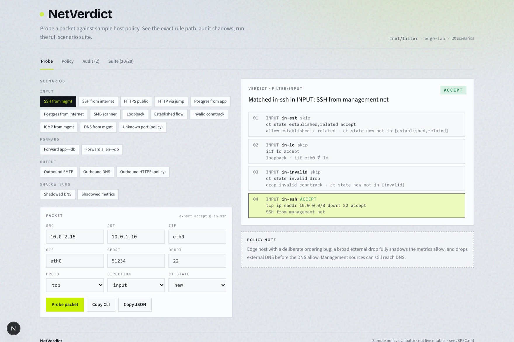
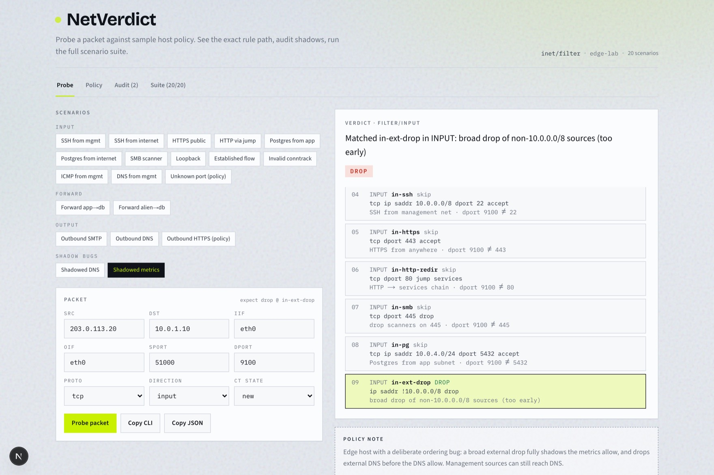
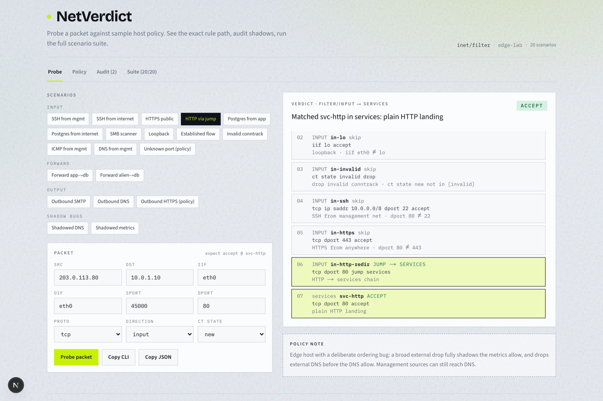
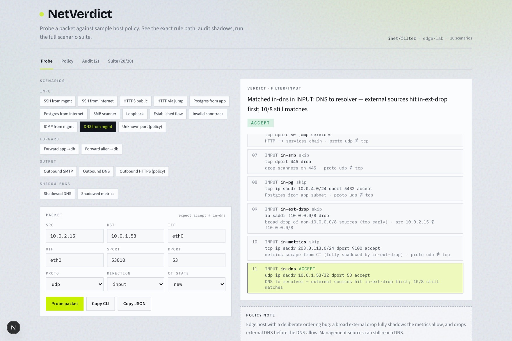
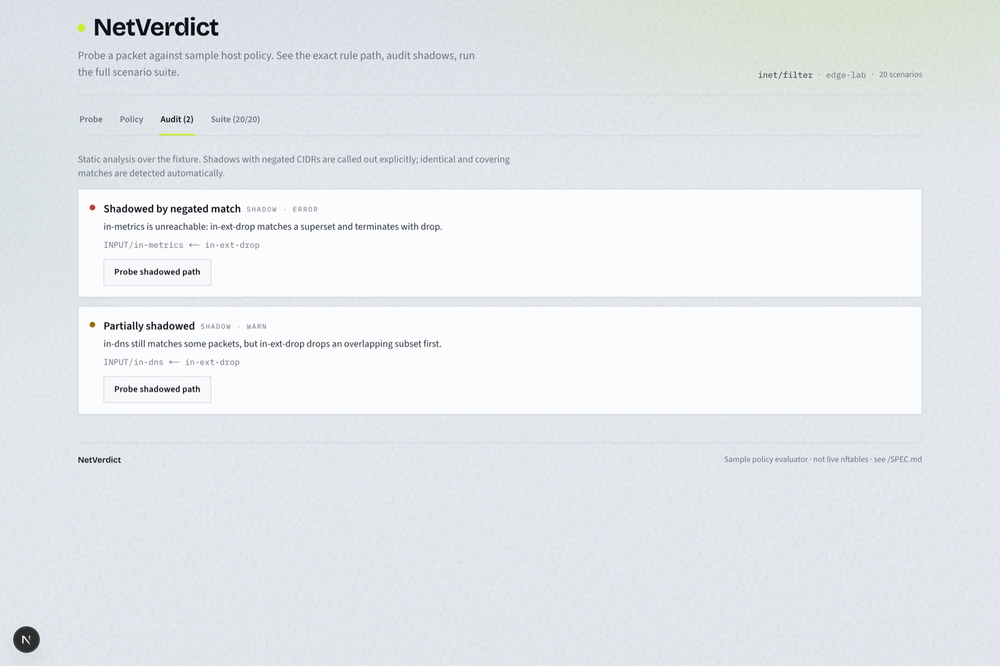
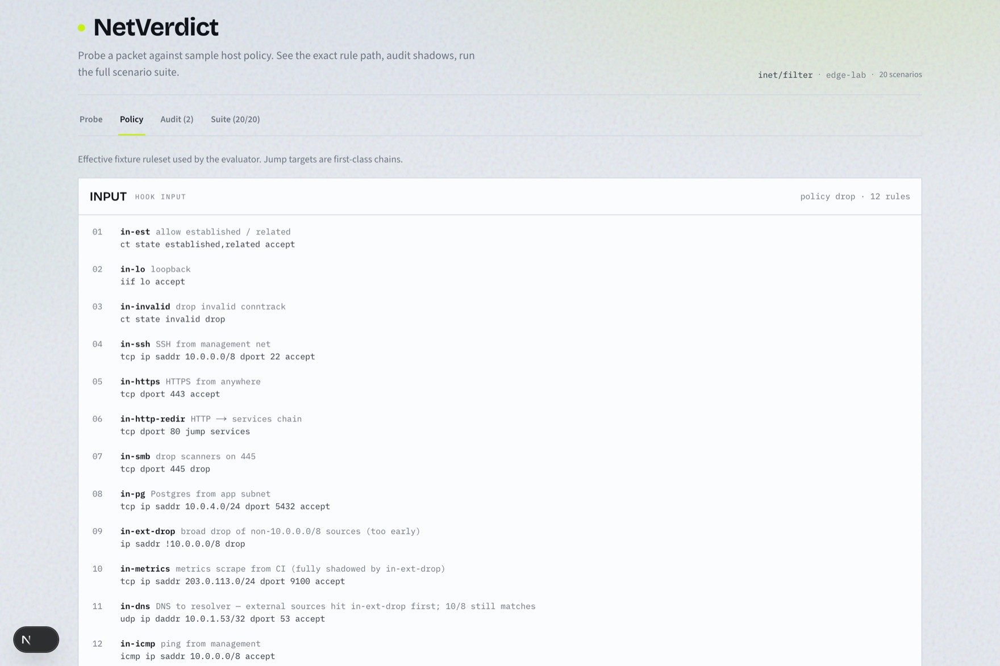
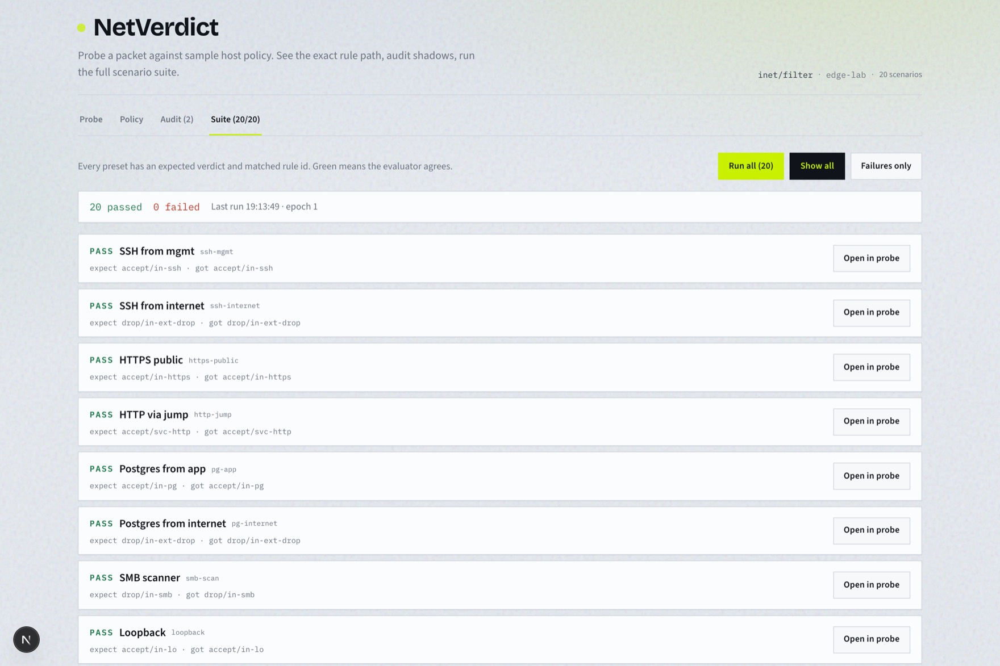

# NetVerdict

Firewall debugger. Give it a packet and a policy; it returns the verdict, the rule that produced it, and the rules that never got a chance.

This repository is the working seed: a browser console over a deterministic evaluator, a fixture policy with a real ordering bug, and the same checks the UI runs. It does not replace nftables, and it does not read a live ruleset. The product direction for collectors, a CLI, and CI is in [`public/SPEC.md`](public/SPEC.md). The app serves that same file at `/SPEC.md`.

Tagline: *Know why the firewall said no.*

## Console

Open the app and the probe workspace is the product. The left side is the packet. The right side is the trace: every rule the walker touched, why it skipped, and the one that terminated.

SSH from `10.0.2.15` to port 22 is accepted by `in-ssh`. Established, loopback, and invalid are visited first and skipped because the conntrack state is `new` and the interface is `eth0`.



A metrics scrape from `203.0.113.20` to port 9100 never reaches `in-metrics`. `in-ext-drop` matches `ip saddr != 10.0.0.0/8` earlier and drops the packet. The accept below it is dead for every address it was written to allow.



HTTP is not flattened. `in-http-redir` jumps to the `services` chain, and `svc-http` accepts. The trace keeps both steps.



DNS is the case that looks like the metrics bug and is not. The same early drop catches `203.0.113.50 → 10.0.1.53:53`, but a source inside `10.0.0.0/8` still matches `in-dns` and is accepted. A single unlucky sample is not enough to call this rule dead.



Audit reports those two facts and nothing else on this fixture. Metrics is an error: the earlier match is a superset. DNS is a warning: some packets still hit the allow, and an earlier deny takes the rest.



The Policy tab is the ruleset the evaluator actually walks, in order, including the jump target.



Every preset is a contract: expected verdict and expected matched rule id (`null` means the chain policy). The Suite tab and `npm test` both call `runSuite(DEMO_POLICY, PRESETS)`. On this tree that is 20 passed, 0 failed.



## Run

Node.js 20 or newer.

```bash
npm install
npm run dev
```

Open [http://127.0.0.1:3847](http://127.0.0.1:3847). Dev listens on that port with webpack. `127.0.0.1` is allowed as a dev origin so the client bundle loads; `localhost` and `127.0.0.1` are different hosts to Next.js.

```bash
npm run build
npm run start
```

Same URL, production build.

| Script | What it does |
| --- | --- |
| `npm run dev` | Dev server on port 3847 |
| `npm run build` / `npm run start` | Production build, then serve it on 3847 |
| `npm test` | Vitest: evaluator, audit, CIDR, validation, the 20 scenarios |
| `npm run lint` | ESLint |
| `npm run test:ui` | Playwright against port 3847. Reuses a server that is already up, otherwise starts `npm run dev` and stops it |

`npm run test:ui` needs Chromium once: `npx playwright install chromium`.

Current bar: **35** unit tests, **54** UI checks.

## Using it

**Probe.** Pick a scenario or edit the packet. An invalid IPv4, a port outside 0–65535, or a blank interface blocks evaluation. ICMP sets both ports to 0. **Probe packet** replays the path. **Copy CLI** writes a `netverdict probe ...` line with shell-quoting. **Copy JSON** writes the packet, the verdict, and the path.

**Policy.** Chains in walker order. A chain with a hook shows `policy accept` or `policy drop`. A user chain shows `implicit return`.

**Audit.** Findings for this fixture, each with **Probe shadowed path**. That button loads a packet that actually demonstrates the finding.

**Suite.** **Run all**, then **Failures only** or **Open in probe**.

## Fixture `edge-lab`

`inet filter`. INPUT defaults to drop. The teaching bug is rule order: `in-ext-drop` (`saddr != 10.0.0.0/8`) sits above two allows that were meant for external clients.

| Chain | Hook | When the chain ends with no verdict |
| --- | --- | --- |
| `INPUT` | input | drop |
| `services` | none (user chain) | return to the caller. The stored policy is not applied |
| `FORWARD` | forward | drop |
| `OUTPUT` | output | accept |

INPUT, in order:

1. `in-est` — accept established / related
2. `in-lo` — accept `iif lo`
3. `in-invalid` — drop invalid conntrack
4. `in-ssh` — accept TCP/22 from `10.0.0.0/8`
5. `in-https` — accept TCP/443
6. `in-http-redir` — TCP/80 jumps to `services`
7. `in-smb` — drop TCP/445
8. `in-pg` — accept TCP/5432 from `10.0.4.0/24`
9. `in-ext-drop` — drop sources outside `10.0.0.0/8`
10. `in-metrics` — TCP/9100 from `203.0.113.0/24`. Fully shadowed by rule 9
11. `in-dns` — UDP/53 to `10.0.1.53`. Still reached from inside `10.0.0.0/8`
12. `in-icmp` — ICMP from `10.0.0.0/8`

`services` accepts TCP/80 and otherwise returns. FORWARD allows established traffic and `10.0.4.0/24 → 10.0.1.20:5432`, then drops other TCP/5432. OUTPUT rejects TCP/25 and accepts UDP/53 on `oif eth0`; everything else hits the accept policy.

## Engine

The walker selects the chain whose `hook` equals the packet direction. The chain name does not have to be `INPUT`. It then walks rules in order.

A rule matches only if every field it sets matches. Supported fields:

| Field | Behavior |
| --- | --- |
| `iif`, `oif` | Exact interface name |
| `proto` | `tcp`, `udp`, or `icmp` |
| `sport`, `dport` | Exact port |
| `saddrCidr`, `daddrCidr` | IPv4 CIDR. A leading `!` negates it. A bare address is `/32` |
| `ctState` | Packet state is one of the listed states |
| `any`, or an empty match | Matches every packet |

IPv4 must be canonical dotted decimal. `01.2.3.4`, `1e1.0.0.1`, and `0x10.0.0.1` are rejected. Prefixes with leading zeros, extra slashes, or internal spaces are rejected. Addresses and interface names are trimmed before the walk.

Actions:

| Action | Effect |
| --- | --- |
| `accept`, `drop`, `reject` | Terminal verdict |
| `jump` | Walk the named chain. A missing or blank target is a drop |
| `return` | Leave the current chain. In a base chain this applies the chain policy |
| `continue` | Record the match and keep walking |

A user chain that runs out of rules returns to the caller. A base chain that runs out of rules uses its policy. Jump depth stops at 32 and drops, so a cycle cannot spin.

`matchCovers(outer, inner)` is true when every packet that matches `inner` also matches `outer`. That includes a negated CIDR covering a prefix that sits entirely outside it: `!10.0.0.0/8` covers `203.0.113.0/24` and does not cover `10.0.4.0/24`. An unconstrained field on the outer match covers a constrained field on the inner one. The reverse is not a cover.

## Audit

`auditPolicy` walks each chain once. It does not hard-code fixture rule ids.

| Kind | Severity | When |
| --- | --- | --- |
| `shadow` | error | An earlier terminating rule's match covers a later rule, so the later rule cannot run. `return` counts. A jump with no target counts as drop |
| `shadow` | warn | The later accept still wins for at least one concrete packet, and an earlier non-boilerplate `drop` or `reject` takes an overlapping packet. Boilerplate guards (conntrack-only, and accept on `iif lo`) are not reported as partial shadows |
| `duplicate` | warn | Two rules in one chain have the same match fingerprint |
| `broad-accept` | warn | An unconstrained accept sits above later rules |
| `smell` | error or info | Broken jump, unparsable CIDR, port outside 0–65535, empty conntrack list, duplicate chain name or hook, INPUT policy `accept` |

A failed sample search is not a shadow. Full shadow is only the cover proof above. On `edge-lab` that yields exactly two findings: `in-metrics` (error) and `in-dns` (warn).

What this pass will not claim: a jump into a chain that happens to accept every relevant packet, when the jump match itself is not a superset of the later rule. That needs a fuller region subtraction than this seed does.

## Scenarios

`null` in the rule column means the chain policy.

| Id | Label | Verdict | Rule |
| --- | --- | --- | --- |
| `ssh-mgmt` | SSH from mgmt | accept | `in-ssh` |
| `ssh-internet` | SSH from internet | drop | `in-ext-drop` |
| `https-public` | HTTPS public | accept | `in-https` |
| `http-jump` | HTTP via jump | accept | `svc-http` |
| `pg-app` | Postgres from app | accept | `in-pg` |
| `pg-internet` | Postgres from internet | drop | `in-ext-drop` |
| `smb-scan` | SMB scanner | drop | `in-smb` |
| `loopback` | Loopback | accept | `in-lo` |
| `established` | Established flow | accept | `in-est` |
| `invalid-ct` | Invalid conntrack | drop | `in-invalid` |
| `icmp-mgmt` | ICMP from mgmt | accept | `in-icmp` |
| `shadow-dns` | Shadowed DNS | drop | `in-ext-drop` |
| `shadow-metrics` | Shadowed metrics | drop | `in-ext-drop` |
| `fw-app-db` | Forward app→db | accept | `fw-app-db` |
| `fw-other-db` | Forward alien→db | drop | `fw-deny-db-world` |
| `out-smtp` | Outbound SMTP | reject | `out-smtp` |
| `out-dns` | Outbound DNS | accept | `out-dns` |
| `out-https-policy` | Outbound HTTPS (policy) | accept | policy |
| `dns-internal` | DNS from mgmt | accept | `in-dns` |
| `input-policy-drop` | Unknown port (policy) | drop | policy |

## Layout

```
.
├── README.md
├── public/SPEC.md               # product charter; served at /SPEC.md
├── docs/screenshots/            # the captures above, from the running console
├── postcss.config.mjs           # Tailwind v4
├── scripts/ui-smoke.mjs         # Playwright end-to-end
└── src/
    ├── app/                     # Next.js shell
    ├── components/Workspace.tsx # Probe, Policy, Audit, Suite
    └── lib/
        ├── policy.ts            # fixture and presets
        ├── ip.ts                # IPv4 and CIDR
        ├── validate.ts
        └── evaluate.ts          # probe, audit, suite
```

## Limits

The evaluator implements the match fields in the table above. No IPv6, no sets or maps, no interface wildcards, no ICMP type or code, no marks. An unsupported match is not silently ignored, because it cannot be written in this model. A live nftables dump is out of scope until a collector exists; see `public/SPEC.md`.

The demo runs entirely in the browser on the fixture. No root, no telemetry, no secrets.

## License

Apache-2.0. Product name NetVerdict. Intended CLI binary `netverdict`.
